# OSRS Companion

A RuneLite plugin that syncs your game data (farming timers, bank, skills, loadouts, loot, collection log, quests, diaries, combat achievements, boss kill counts, slayer and your Kingdom of Miscellania) to the OSRS Companion website, and brings the website's tools into the game: your current roadmap goal, the farm run guide, boss gear and the slayer helper. Most of the work (timers, trips, task outcomes, guide steps) is done by the website from what the plugin sends, which keeps the plugin small.

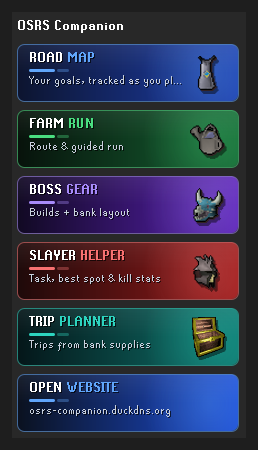

## Settings

Settings are grouped into **Data Syncing** (which data the plugin sends to the app; one toggle per source) and **Plugin Features** (the in-game current goal overlay with its progress bar, the goal completion popup and its sound). Your OSRS Companion App Key sits at the top.

## Roadmap

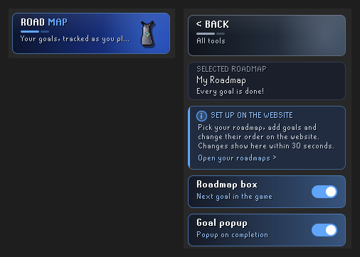 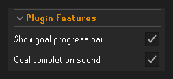

The goal overlay shows your current roadmap goal and the progress the website works out from what the plugin syncs (it updates within about 30 seconds). Your roadmaps are set up on the website; the side panel's **Roadmap** page links there. The completion sound (an in-game sound effect, at your sound effect volume) can be switched off in the settings.

## Farm run guide

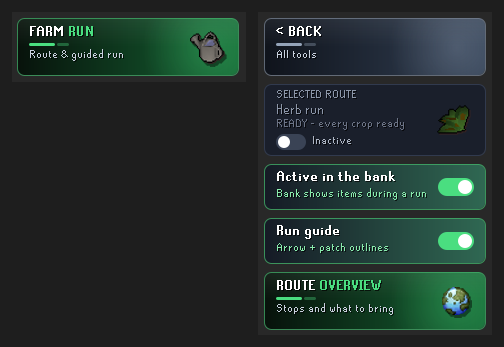 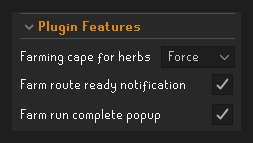

Start a run from the side panel's **Farm run** page or the farm run window: the guide points you from stop to stop, says what to do at each patch and what to bring. It reads the patches from the game itself, so a stop is ticked off the moment you plant it, also when the website cannot be reached; the website keeps the run's state and the run history.

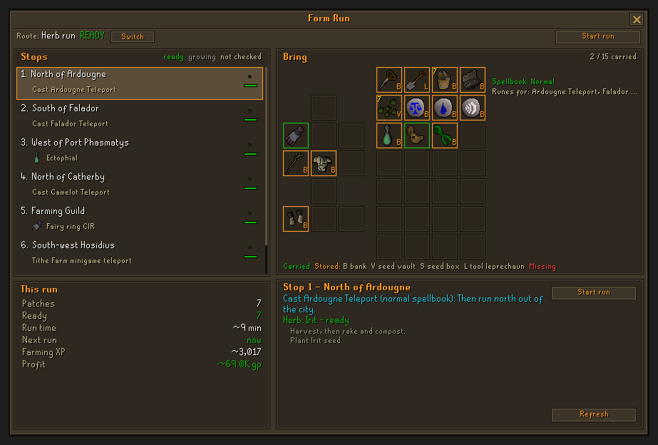

## Boss gear

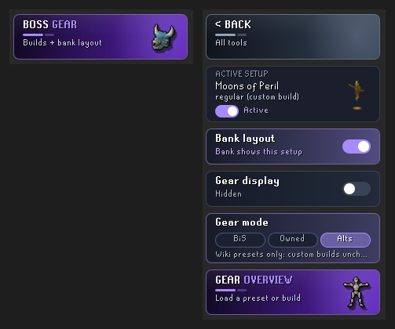

The **Boss gear** page in the side panel shows the active setup (a wiki preset or one of your custom builds from the website) and turns it on or off. **Bank layout** makes the bank show only that setup's items, laid out like your gear and inventory; **Gear display** shows the gear in the side panel; **Gear mode** (wiki presets only) picks the wiki's best in slot, the best you own from the wiki's list, or that plus your own alternatives. **Gear overview** opens the Boss gear window: the worn gear and inventory, green when you carry it, **B** when it is in your bank or storage, red when it is missing. **Save my gear** stores what you wear and carry as a custom build, **Change build** loads another one and **Go to wiki** opens the boss's strategy guide in your browser.

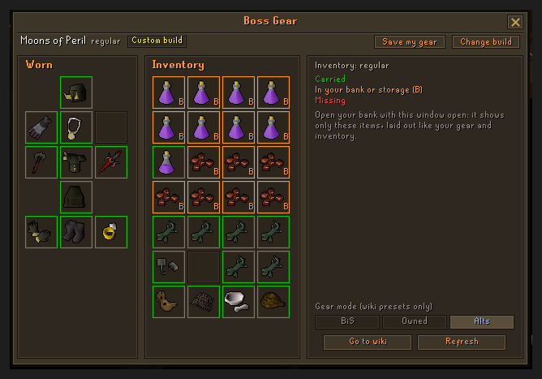

## Slayer helper

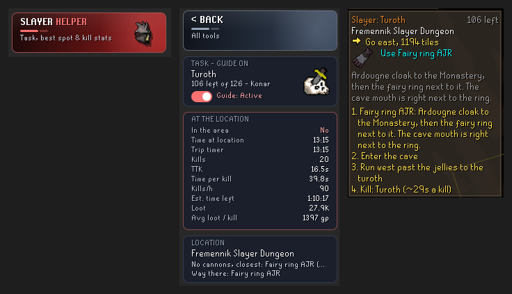

The **Slayer helper** tile in the side panel shows your task (kills left, master) and the best place to do it (or the one you picked on the website). Switch the **Guide** on and a step box, the hint arrow and a Slayer icon on the world map lead you there; click the icon for the way there in a popup. Once you are in the area the box shows the task's stats instead: time at the location, average kill time (each monster timed on its own, so barraging stays valid), kills per hour, estimated time left and loot. Each visit is sent to the website (with Slayer syncing on), which charts it per task.

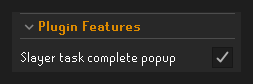

## Data sent and privacy

This plugin sends data to a **third-party server**: the OSRS Companion website at `https://osrs-companion.duckdns.org`. It is not run or checked by the RuneLite developers.

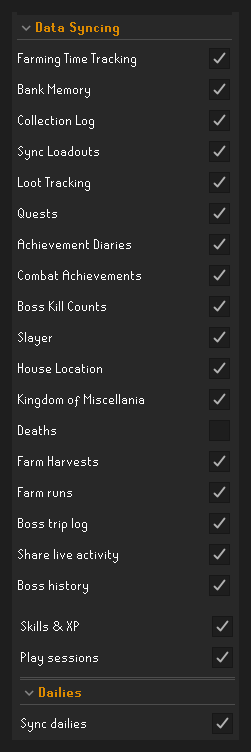

- **Nothing is sent until you enter an App Key** (from your account settings on the website). RuneLite asks you to confirm when you set it. Clear the App Key to stop all sending.
- Every request carries your App Key (to link it to your website account) and your RuneScape name.
- Each source under **Data Syncing** has its own switch. With the App Key set, the plugin sends: skill levels and XP (with your total and combat level and account type); play sessions (login, logout and a ping while you play); farming patches, bird houses and farming unlocks; bank, seed vault, looting bag, potion storage, boat cargo holds, rune pouch, plank sack and storage items; the collection log; worn gear and your Inventory Setups loadouts; loot drops and kill counts (with a random per-install client id that is used to deduplicate them); quests; achievement diaries; combat achievements; boss kill counts; slayer task, points, unlocks and visits; boss trips (supplies used and loot per trip) and the boss history (each visit to a boss: its trips, bank visits, kills, kill times, deaths, drops with their GE value, the supplies used and the map regions the kills happened in); your house location; Kingdom of Miscellania; farm harvests and farm runs; dailies. These are on by default once you set an App Key. **Deaths** is off by default and currently sends nothing: the website does not store deaths yet.
- **Game events** (with **Boss trip log**, **Boss history**, **Farm Harvests**, **Slayer** or **Bank Memory** on): the website works out boss trips, the boss history, farm harvests, how slayer tasks ended and what your storage items (fish barrel, log basket, gem bag, coal bag, herb sack) hold from what happens in game, sent as it happens (in batches about every 30 seconds): the game's own messages (game and filtered messages; never chat from players), your inventory and worn items when they change, Cooking, Firemaking and Farming XP gains, your map region, the NPC you attack and the deaths of NPCs you attacked, your own deaths, loot, opening the bank or a deposit box, clicks on farming patches and on storage items (Fill, Empty, Check), the slayer state as the game shows it, what RuneLite's Time Tracking stores and the Charges Improved plugin's storage contents (read only).
- **Share live activity** (**off** by default, under Data Syncing): when you switch it on, it sends while you are logged in your online or idle status, your current activity (a raid or minigame, boss, slayer task, farm run, the NPC you fight, the skill you train with the item it gives, banking, or idle; for Magic the spell: where you teleported to, the item you high alch, the monster you train Magic on), how long you have been at it, your world and the area name (or map region). It goes out at once when your activity, area or world changes, along with the other uploads, or on its own every 5 minutes when nothing else was sent, and "offline" when you log out. You and the website's admin can see it. Switch it off and nothing more is sent; the website then shows you as offline.
- The plugin also loads your roadmaps, farm routes and the farm run's state, boss gear setups and slayer guide from the website, and goal images from the OSRS Wiki (see [OSRS Wiki: what is loaded and how often](#osrs-wiki-what-is-loaded-and-how-often)).
- The plugin skips syncing on Leagues, Deadman and other special game-mode worlds. It collects no data about other players.
- You can delete your account on the website (Settings): that removes your email, your characters and all their data.
- The website's [privacy page](https://osrs-companion.duckdns.org/privacy) explains what is stored, who can see it and how long it is kept.

## OSRS Wiki: what is loaded and how often

**The plugin** loads only two kinds of picture from the wiki:
- **The current roadmap goal's picture**, in the roadmap box and on the side panel's Roadmap page. A roadmap shows one goal at a time (the first one not done yet), so at most **one** picture until that goal is reached; then the next goal's. Item and skill goals use RuneLite's own icons and load nothing from the wiki.
- **The active boss setup's picture** on the side panel's Boss gear page: one, until you load another setup.

Each picture is loaded once, then kept in memory (at most 512) until RuneLite closes or the plugin is turned off. Only `https://oldschool.runescape.wiki/images/...` files are loaded; any other address is ignored. A picture that fails is not asked again until the next start, and at most 16 load at once. Wiki links (the boss gear's **Go to wiki**, the slayer guide) open in your browser only when you click them.

The website itself also loads data from the wiki (item names, prices, WikiSync). What exactly, how often, and an estimate of the data per player per day are in [docs/wiki-usage.md](docs/wiki-usage.md).

## Collection log: why the plugin opens the log's search

The game only draws the collection log items of the page you look at. To read the whole log at once, the plugin does what the [WikiSync](https://github.com/weirdgloop/WikiSync) plugin does: the first time you open your collection log in a session (with **Collection Log** syncing on and an App Key set), it calls `client.menuAction` once for the log's own **Search** button and runs the client's search script. That makes the game draw every item you have, which the plugin reads. It is a client-side action on an interface you opened yourself; it sends no game action to the server, clicks nothing else, and never runs on its own outside that moment.

## Settings that change clicks (off by default)

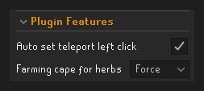

- **Auto set teleport left click** (Plugin Features): during a farm run or a Slayer guide step, the teleport the step uses becomes the left click of that item, the way RuneLite's Menu Entry Swapper swaps options. Off by default.
- **Farming cape for herbs** (Plugin Features): **Remind** (the default) adds the cape to the run and reminds you to wear it. **Force** also makes a left click on a ready herb patch walk instead of pick until you wear the cape. **Off** does neither.

## Bank Tag Layouts plugin

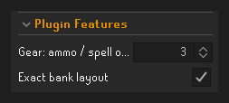

The boss, farm run and slayer gear bank layouts use RuneLite's built-in Bank Tags layouts. If you also run the **Bank Tag Layouts** plugin from the Plugin Hub with **Enable layout by default** on, it re-sorts our layout into its own order (and keeps that order for good): the bank still shows only the items you need, just not in their slots. OSRS Companion never changes another plugin's settings, so on the first bank visit of each login where one of our layouts opens, it tells you in the chat that turning the Bank Tag Layouts plugin off gives our neater layout.

## Plugin Hub release

Version `1.0.0` (set in `src/main/resources/com/osrscompanion/version.properties` and in `runelite-plugin.properties`, which the Plugin Hub shows). The first submission (runelite/plugin-hub#18254) was closed because the plugin was over the hub's 200,000-token review limit; the rework in [docs/rework.md](docs/rework.md) brought it to about 193,500 (`PluginSizeTest` fails the build above 195,000). The review points are in [docs/plugin-hub-review.md](docs/plugin-hub-review.md) and the pull request text in [docs/plugin-hub-pr.md](docs/plugin-hub-pr.md).

Every later update: raise `version` in both `version.properties` and `runelite-plugin.properties` (1.0.1, 1.1.0 ...) in the commit the hub update points at, and keep the review size under 195,000.

## License

BSD 2-Clause, see [LICENSE](LICENSE).
